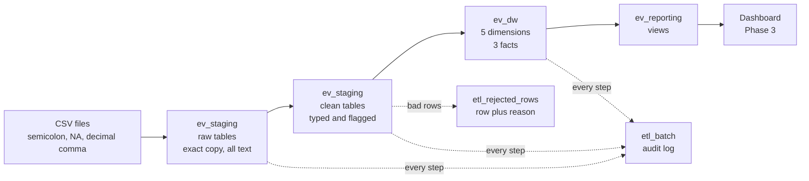
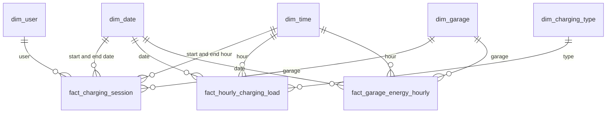

<div align="center">

# ⚡ EV Charging Demand and Energy Utilization Analytics

### From raw CSVs to a star schema, from a star schema to answers.


*DL3004 Data Warehousing and Business Intelligence Lab, FAST-NUCES Lahore, Fall 2026*

**Laiba Shahzad (24L-2600) · Abdulahad (24L-2594) · Yousuf Iqbal (24L-2539)**

</div>

---

## 🔌 The story

A housing cooperative in Trondheim, Norway put EV chargers in its garages and logged everything: every plug-in, every kilowatt-hour, every hour of the day. The result is a pile of semicolon-separated files with decimal commas, `NA` for missing values, and a clock change that makes one hour happen twice.

This project turns that pile into a proper analytical warehouse. Raw files go in, clean and trusted facts come out, and every row can be traced back to the line it came from.

**Data source:** *Residential electric vehicle charging datasets from apartment buildings*, Sorensen, Lindberg, Sartori and Andresen, Data in Brief 36 (2021) 107105. Mendeley Data, DOI 10.17632/jbks2rcwyj.2.

| Data | What it is | Real or estimated |
|---|---|---|
| Charging sessions (Dataset 1) | One row per plug-in | Real |
| Hourly load, private and shared (3a, 3b) | Hourly load for two kinds of charge points | Synthetic estimates |
| Garage Bl2 meter data (Dataset 5) | Hourly smart meter reading of one garage | Real |

---

## 🗺️ The pipeline



It is an **ELT** pipeline written entirely in SQL: load first, then transform inside PostgreSQL.

Three rules the whole project follows:

1. **Raw data is never changed.** The raw tables are an exact text copy of each file.
2. **No row disappears without a reason.** A row is either loaded, flagged, or rejected with a written reason.
3. **Missing is not zero.** `NA` becomes `NULL`, never `0`.

---

## ⭐ The star schema



| Fact table | One row is | Rows | Source |
|---|---|---|---|
| `fact_charging_session` | one charging session | 6,878 | Dataset 1 |
| `fact_hourly_charging_load` | one hour for one charging type | 19,045 | Datasets 3a and 3b |
| `fact_garage_energy_hourly` | one hour for garage Bl2 | 9,466 | Dataset 5 |

| Dimension | Rows | Notes |
|---|---|---|
| `dim_date` | 1,096 | Whole calendar years, generated from the data |
| `dim_time` | 24 | One per hour, with 8 three-hour dayparts |
| `dim_user` | 109 | One row per user and user type, plus an Unknown row |
| `dim_garage` | 25 | 24 garages plus an Unknown row |
| `dim_charging_type` | 2 | Private and Shared |

Facts store **surrogate keys only**. The three facts live at different grains, so they are never joined row to row. Each one is aggregated first and compared through the shared date and time dimensions. That is how double counting is avoided.

---

## 🧹 Weird data, handled

| Problem found | What we did |
|---|---|
| `NA` text for missing values | Turned into `NULL`, never into 0 |
| Decimal commas (`3,25`) and text dates | Converted with strict pattern checks. A value that fails goes to the reject table |
| Numbers like `1,60E-15` | Accepted as valid scientific notation. The first run rejected 4 of them, which also proved the reject path works |
| 34 sessions with no end time | Kept, flagged `MISSING_END`, left out only of duration math |
| 22 sessions where duration does not match end minus start | Source duration kept, flagged `DURATION_MISMATCH`. 17 sit on the clock-change night, 5 are unexplained |
| An hour that happens twice when the clocks go back | Both rows kept, numbered with `hour_occurrence`, flagged `REPEATED_HOUR` |
| Users who switch between Private and Shared | One `dim_user` row per user and type, so every session keeps its correct type |
| Missing values in the garage file | Flagged `MISSING_SYNTHETIC`, `MISSING_AMS` or `MISSING_DATE_TO`, never set to 0 |

---

## ✅ Mission log: does it add up?

| Check | Result |
|---|---|
| Raw rows, clean rows, fact rows | 35,389 = 35,389 = 35,389 |
| Rejected rows | 0 |
| Session energy, raw against fact | 87,493.28 kWh = 87,493.28 kWh |
| Hourly synthetic 3.6 kW load, raw against fact | 87,462.60 = 87,462.60 |
| Garage AMS energy, raw against fact | 28,275.25 kWh = 28,275.25 kWh |
| Orphan fact rows (every foreign key) | 0 |
| Duplicate business keys | 0 |
| Deliberate bad inserts (foreign key, unique key, negative energy) | 3 of 3 rejected |
| Load log steps | All `SUCCESS` |

The full story is in the two reports inside `docs/`.

---

## 📁 Repository map

```
.
├── docs/             Phase 1 documents, schema diagram, Data Cleaning Report, Data Quality Report
├── data/             source CSV files (Datasets 1, 3a, 3b and 5 are loaded, Dataset 2 is not)
├── ETL/              staging.sql, dimensions.sql, facts.sql, data_quality.sql
├── Data Warehouse/   warehouse.sql
├── Dashboard/        Phase 3
└── README.md
```

---

## 🚀 Run it yourself

You need PostgreSQL and pgAdmin 4. Use one empty database. In pgAdmin, highlight a block and press F5 when only part of a file must run.

| Step | What to run |
|---|---|
| 1 | `ETL/staging.sql`, from the top until the `alter table` lines. This creates the schemas, the log tables and the 4 raw tables |
| 2 | Import the 4 CSVs into the raw tables with pgAdmin (right click the table, Import/Export Data). Format csv, header yes, delimiter `;`, NULL strings left empty |
| 3 | `ETL/staging.sql`, from the `alter table` lines to the end. This adds lineage columns, then profiles and cleans the data |
| 4 | `Data Warehouse/warehouse.sql` creates the dimension and fact tables and the reporting view |
| 5 | `ETL/dimensions.sql` |
| 6 | `ETL/facts.sql` |
| 7 | `ETL/data_quality.sql`. The 3 constraint tests at the end must fail, so run them one at a time |

Which file goes into which table in step 2:

- `raw_sessions` takes Dataset 1 (EV charging reports)
- `raw_hourly_private` takes Dataset 3a (aggregated private)
- `raw_hourly_shared` takes Dataset 3b (aggregated shared)
- `raw_garage_ams` takes Dataset 5 (AMS data from garage Bl2)

---

## 🔭 What comes next: the dashboard

Phase 3 turns the warehouse into answers. The warehouse was designed around ten questions:

1. How many charging sessions happen each month?
2. Which hours of the day are the busiest?
3. Which weekdays are the busiest?
4. How much energy is used each month?
5. How does the average energy per session change over time?
6. How does session duration vary by weekday and hour?
7. How do private and shared users differ?
8. How does energy use differ between garages?
9. How do private and shared hourly loads differ by hour?
10. How do the synthetic and flexible load scenarios compare?

The plan is reporting views in `ev_reporting`, OLAP queries with `ROLLUP` and `CUBE`, index tuning checked with `EXPLAIN ANALYZE`, and a Power BI dashboard.

---

## 🧠 Good to know

- The four hourly scenario columns (synthetic and flex, at 3.6 and 7.2 kW) are estimates under different assumptions. They are kept apart and never added together.
- Only the garage `AMS_kWh` column is measured energy.
- Every load uses unique business keys with `on conflict do nothing`, so running a load again adds no duplicates.
- Phase 2 added a few columns to the Phase 1 schema: `hour_occurrence`, `data_quality_flag`, `batch_id` and `loaded_at` on the facts, a `description` on `dim_charging_type`, and Unknown rows (key -1) in `dim_user` and `dim_garage`. `simultaneous_if_3_6kw` is an integer because the source defines it as a count of sessions.
- Dataset 2 (hourly load per user) sits in `data/` but is outside the project scope and is not loaded.
